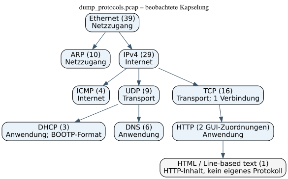

# Ü 2.11 – Protokolle mit Wireshark

## Angabe und Material

`dump_protocols.pcap` analysieren, alle verwendeten Netzwerkprotokolle dem TCP/IP-Modell zuordnen und die Hierarchie grafisch darstellen. Original unter `../Angabe/`. Die Nummer 2.3 kommt auf dem Aufgabenblatt nicht vor.

Die Datei wurde tatsächlich mit Wireshark 4.4.5 geöffnet. Unveränderte GUI-Exporte und Screenshots liegen unter `../ue2.10/`. Zusätzlich wertet `analyse.py` die Originalbytes ohne Wireshark oder externe Python-Pakete aus. Die Tests vergleichen die Ergebnisse mit den unabhängigen GUI-Exporten.

## Beobachtete Protokolle und Schichten

Vier Schichten nach RFC 1122:

- **Netzzugang / Link:** Ethernet in **39 Frames**; ARP in **10 Frames**. Ethernet überträgt Frames im lokalen Netz. ARP löst IPv4-Adressen zu MAC-Adressen auf und läuft direkt in Ethernet, **nicht über IP oder UDP**. RFC 1122 behandelt ARP im Link-Layer (§2.3.2); es verbindet funktional IP-Adressierung und lokalen Link.
- **Internet:** IPv4 in **29 Frames**, ICMP in **4 Frames**. IPv4 adressiert und transportiert Datagramme über Netze. ICMP transportiert Diagnose-/Fehlermeldungen; hier zwei Echo-Requests und zwei Echo-Replies. Obwohl ICMP in IPv4 gekapselt ist, gehört es funktional zur Internetschicht, nicht zur Transportschicht.
- **Transport:** UDP in **9 Frames**; TCP in **16 Frames**. UDP trägt hier DHCP und DNS, TCP trägt HTTP. Genau **eine TCP-Verbindung**: `192.168.1.215:54961 ↔ 192.168.1.1:80`.
- **Anwendung:** DHCP in **3 Frames** (Request, ACK, Release) und DNS in **6 Frames** (drei Anfragen und drei Antworten). HTTP besteht hier aus einem Request und einer Response. Wireshark ordnet nach Reassemblierung **2 Frames HTTP** und **1 Frame „Line-based text data“** zu. Das ist keine Zählung sämtlicher TCP-Segmente mit HTTP-Bytes.
- **Keine zusätzliche TCP/IP-Schicht:** „Frame“ ist Wiresharks Aufnahme-Metainformation. „Line-based text data“ ist die Darstellung des HTML-Inhalts der HTTP-Antwort, kein weiteres eigenständiges Netzwerkprotokoll. DHCP benutzt das BOOTP-Nachrichtenformat; Wireshark 4.4.5 bezeichnet die beobachteten Nachrichten als DHCP, nicht als zusätzlich unabhängigen BOOTP-Austausch.

Es sind in dieser Aufnahme **kein TLS/HTTPS, kein IPv6 und keine IEEE-802.11-Frames** nachgewiesen. Ethernet-Kapselung beweist nicht, dass der gesamte reale Übertragungsweg ausschließlich aus Ethernet bestand.

**Zählkonvention:** Ein Frame kann mehrere Schichten enthalten, deshalb darf man alle Protokollzahlen nicht addieren. Die 29 IPv4-Frames enthalten 9 UDP-, 16 TCP- und 4 ICMP-Frames; zusammen mit den 10 ARP-Frames decken sie die 39 Ethernet-Frames ab. Enthaltene Nutzdaten sind bereits in den äußeren Frames enthalten.

## Grafische Hierarchie



```text
Frame / Ethernet (39)                         [Netzzugang]
├── ARP (10)                                  [Netzzugang]
└── IPv4 (29)                                 [Internet]
    ├── ICMP (4)                              [Internet]
    ├── UDP (9)                               [Transport]
    │   ├── DHCP (3), BOOTP-Format             [Anwendung]
    │   └── DNS (6)                           [Anwendung]
    └── TCP (16), eine Verbindung             [Transport]
        └── HTTP (2 GUI-Zuordnungen)           [Anwendung]
            └── HTML / Line-based text (1)    [Inhalt]
```

Die Äste zeigen **Kapselung**, die Klammern rechts die funktionale Schicht. Das ist der Grund, warum ICMP trotz eigener Ebene im Baum ebenfalls zur Internetschicht gehört. Der Graph wird aus `hierarchie.dot` gerendert und bildet die tatsächlich beobachteten Äste ab.

## Konkreter Ablauf des Mitschnitts

1. DHCP Request/ACK bestätigt die Konfiguration; am Ende wird DHCP Release gesendet. Eine vollständige Discover–Offer–Request–ACK-Folge ist **nicht** aufgezeichnet.
2. ARP enthält unter anderem Prüfungen für die eigene IPv4-Adresse sowie die Auflösung des Gateways. Anfragen mit Absenderadresse `0.0.0.0` dienen der Adressprüfung.
3. Zwei ICMP-Echo-Paare prüfen Erreichbarkeit des Gateways.
4. DNS fragt `www.aau.at`, `notexisting.aau.at` und `homegateway.lan` ab. Antworten liefern `143.205.180.80`, einen Namensfehler und `192.168.1.1`. Dies sind **historische Daten aus der Aufnahme**, keine Behauptung über heutige DNS-Einträge.
5. TCP baut die Verbindung zum Gateway auf. `GET / HTTP/1.1` fragt die Startseite ab. Die Antwort verwendet `Transfer-Encoding: chunked`, `Content-Type: text/html` und `Connection: close` und enthält nach Entfernung des Chunk-Framings **577 Body-Bytes**.

## Reproduzieren und prüfen

Aus `ueb02/`:

```bash
python3 -B ue2.11/analyse.py Angabe/dump_protocols.pcap
python3 -B -m unittest discover -s ue2.11 -p 'test_*.py' -v
dot -Tsvg ue2.11/hierarchie.dot -o ue2.11/hierarchie.svg
wireshark -r Angabe/dump_protocols.pcap
```

In Wireshark: **Statistics → Protocol Hierarchy**, dann **Statistics → Conversations → TCP**. Anzeige mit `arp`, `icmp`, `dns`, `dhcp`, `tcp` oder `http` eingrenzen; ältere Wireshark-Versionen verwenden teilweise den Filternamen `bootp` für DHCP. `tcp.stream == 0` zeigt die ganze TCP-Verbindung, nicht nur vollständig reassemblierte HTTP-Nachrichten.

`analyse_protocols.json` enthält alle maschinell berechneten Werte. Der Offlineparser ist für die gelieferten vollständigen klassischen Ethernet/IPv4-PCAPs geschrieben, nicht als allgemeiner Ersatz für Wireshark. VLAN, IPv6, Fragmente, TCP-Sequence-Wrap und beliebige HTTP-Sonderfälle werden nicht unterstützt. Er führt keine Pakete oder HTTP-Inhalte aus und stellt keine Netzwerkverbindung her.

## Quellen

- Originalaufnahme aus Moodle, unverändert unter `../Angabe/dump_protocols.pcap`.
- Tatsächlicher GUI-Export: `../ue2.10/gui_protocol_hierarchy_protocols.csv` und `gui_tcp_conversations_protocols.csv`.
- RFC 1122 §§1.1.3, 2.3.2: https://www.rfc-editor.org/rfc/rfc1122
- ARP, RFC 826: https://www.rfc-editor.org/rfc/rfc826
- DHCP, RFC 2131: https://www.rfc-editor.org/rfc/rfc2131
- DNS, RFC 1035: https://www.rfc-editor.org/rfc/rfc1035
- HTTP/1.1-Framing, RFC 9112 §7.1: https://www.rfc-editor.org/rfc/rfc9112#section-7.1

## KI-Kennzeichnung

Erstellt mit **Hermes Agent**, Modell **OpenAI gpt-6.1-sol**, Datum **2026-10-19**. Anfrage sinngemäß: „Analysiere die Original-PCAPs, ordne Protokolle zu, zeichne die Hierarchie und liefere unabhängig getesteten, nachvollziehbaren Auswertungscode.“ Keine persönliche Eigenleistung des Studierenden wird behauptet.
