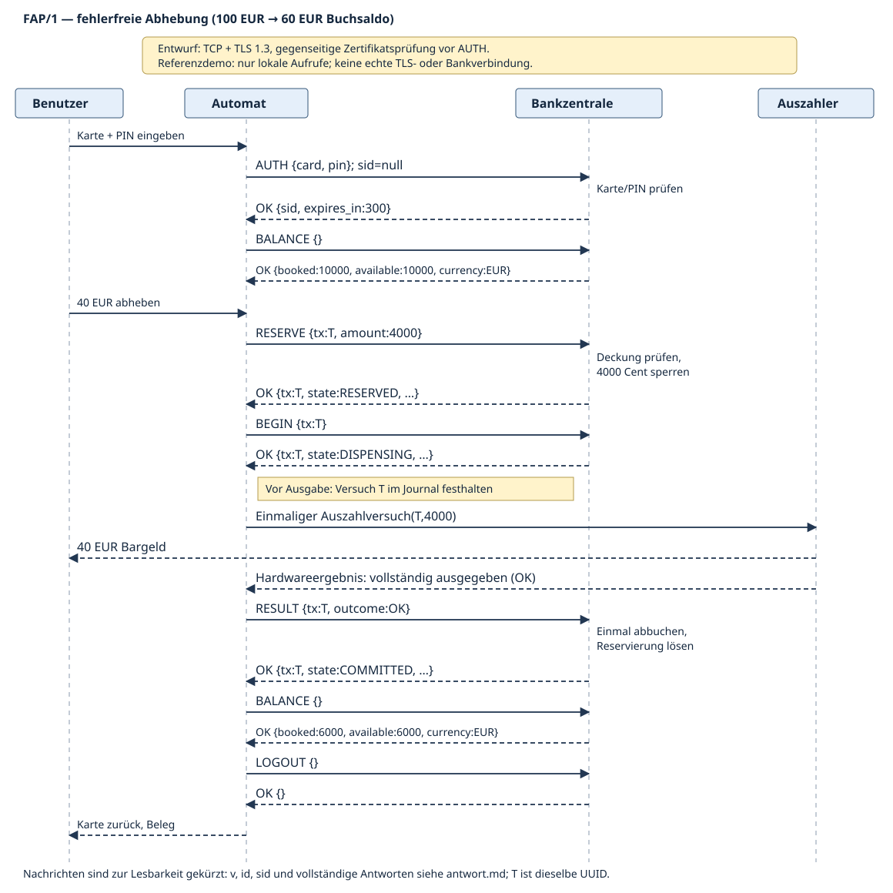

# Ü 2.6 — FAP/1: Fiktives Automatenprotokoll

**Status dieses Dokuments:** Unterrichtsentwurf, RFC-artig gegliedert; kein IETF-RFC und kein existierender Bankstandard. Version 1, 19. Oktober 2026.

## 1. Zusammenfassung und Aufgabenbezug

FAP/1 verbindet einen Geldautomaten mit einer Bankzentrale. Es erlaubt die Prüfung von Karte und PIN, Kontostandsabfragen und Bargeldabhebungen einschließlich Ablehnung bei unzureichender Deckung. Eine Abhebung wird zuerst reserviert, anschließend am Automaten versucht und danach bestätigt oder als fehlgeschlagen beziehungsweise unklar gemeldet.

Die Aufgabenstellung verlangt einen **Entwurf** mit Nachrichten, Aktionen und einer Skizze der fehlerfreien Abhebung. Die Python-Dateien sind eine zusätzlich getestete, didaktische Referenz, **keine produktive Implementierung**. Alle Karten, PINs, Identitäten und Beträge sind erfunden; kein Code verbindet sich mit einer Bank.

### 1.1 Normative Wörter und Rollen

**MUSS**, **DARF NICHT**, **SOLLTE** und **KANN** bezeichnen Anforderungen dieses fiktiven Entwurfs, nicht die Zulassung zu einem realen Bankbetrieb.

- **Benutzer:** steckt die Karte ein, gibt die PIN und den Betrag ein und entnimmt Bargeld.
- **Automat:** erfasst die Eingaben, kommuniziert mit der Bank und steuert den Auszahler.
- **Bankzentrale:** prüft Benutzer und Sitzungen, reserviert Deckung und verbucht die Abhebung.
- **Auszahler:** meldet eindeutig ausgegeben, eindeutig nicht ausgegeben oder unklar. Eine teilweise Ausgabe ist **unklar**, nicht `FAIL`.
- **Prüfinstanz:** klärt ungewisse Auszahlungen anhand unabhängiger Belege und Hardwarejournale; sie ist nicht der normale Automatenclient.

## 2. Transport, Vertrauen und Begrenzungen

Der **Entwurf** verwendet einen zuverlässigen TCP-Bytestrom, geschützt durch **TLS 1.3 mit gegenseitiger Zertifikatsprüfung**. Der Automat MUSS das Bankzertifikat prüfen; die Bank MUSS das Automatenzertifikat einer freigeschalteten Terminalidentität zuordnen. TLS-0-RTT DARF wegen Replay-Risiken für diese Anwendung NICHT verwendet werden. Vor erfolgreicher Transportauthentifizierung DARF keine Anwendungsnachricht verarbeitet werden. TCP allein bietet weder Vertraulichkeit noch Benutzerprüfung; TLS allein beweist keine korrekte physische Auszahlung.

**Wichtige Modellgrenze:** Die Referenz verwendet **weder Sockets noch TLS**, sondern lokale Funktionsaufrufe. `terminal="DEMO-ATM-1"` ist ein **Vertrauens-Stellvertreter** für die vom Transport bereits geprüfte Identität; er DARF in einer Netzwerkimplementierung nicht aus einem vom Client frei wählbaren JSON-Feld stammen. Die Referenz erzwingt die Transportanforderungen deshalb nicht.

| Eigenschaft | Festlegung im Modell |
|---|---|
| Währung | ausschließlich EUR, Beträge als ganze Cent |
| Anfangssaldo Demo | 10000 Cent = 100 EUR |
| Einzelabhebung | 1000 bis 100000 Cent, Vielfaches von 1000 (10-EUR-Stückelung) |
| Anfangssaldo Konstruktor | 0 bis 100000000 Cent; keine Überziehung |
| JSON-Nutzlast | 1 bis 4096 **Bytes**, nicht Zeichen |
| Sitzung | 300 Sekunden ab AUTH, keine gleitende Verlängerung |
| reine Reservierung | 60 Sekunden bis BEGIN; Grenze bereits abgelaufen |
| IDs | kanonische, kleingeschriebene UUID-Zeichenketten; Generator UUIDv4 |
| Karte/Terminal | je 1 bis 64 Zeichen im Modell |
| PIN | exakt vier ASCII-Ziffern als Zeichenkette, damit führende Nullen möglich bleiben |

Im Entwurf MÜSSEN Reservierung, Zustandswechsel, Verbuchung und Deduplizierung atomar und dauerhaft gespeichert werden. Ein Terminal MUSS sein Auszahljournal vor einem Hardwareaufruf dauerhaft sichern. **Die Referenz tut das nicht:** Dictionaries und Locks demonstrieren ausschließlich den Ablauf innerhalb eines laufenden Prozesses. Keine Neustart-, Plattenfehler-, Hochverfügbarkeits- oder Produktionssicherheitsgarantie wird behauptet.

## 3. Nachrichtenformat und Framing

TCP hat keine Nachrichtengrenzen. Auch TLS-Records dürfen nicht mit Anwendungsnachrichten verwechselt werden. Jede FAP-Nachricht besteht deshalb aus:

```text
+------------------------------+----------------------------------+
| Länge: 4 Byte unsigned        | JSON-Objekt: genau Länge Bytes   |
| Big Endian / Network Order   | UTF-8, ohne BOM                  |
+------------------------------+----------------------------------+
```

Die Länge zählt nur die JSON-Bytes, nicht das Präfix. Ein Empfänger MUSS Teilstücke puffern und mehrere Nachrichten aus einem Lesevorgang getrennt auswerten. Länge 0 oder größer als 4096, ungültiges UTF-8, ungültiges JSON, doppelte Objektschlüssel, `NaN`/`Infinity`, ein anderes Wurzelelement als ein Objekt und ein unvollständiger Frame bei EOF führen zum **Verbindungsabbruch**; es wird keine Bankaktion ausgeführt. Nach einem Parserfehler wird derselbe Decoder nicht weiterverwendet. Die Demo ist nicht gegen jede Form von Ressourcenerschöpfung gehärtet; ein echter Transportadapter benötigt zusätzlich begrenzte Lesepuffer und Lesezeitlimits.

### 3.1 Request und Response

Jede Anfrage hat **genau** diese Schlüssel; unbekannte oder fehlende Schlüssel werden abgelehnt:

```json
{"v":1,"id":"11111111-1111-4111-8111-111111111111","op":"AUTH","sid":null,"body":{"card":"DEMO-CARD-A","pin":"1234"}}
```

- `v`: Integer `1`, kein Boolean. Andere Versionen: `BAD_VERSION`.
- `id`: Anfrage-ID zur Zuordnung von Antwort und Anfrage. Sie ist **nicht** der Schutz gegen doppelte Abbuchung.
- `op`: einer der in Abschnitt 4 beschriebenen, großgeschriebenen Namen.
- `sid`: bei `AUTH` JSON-`null`, sonst die gültige Sitzungs-UUID.
- `body`: ein Objekt mit genau den operationsabhängigen Feldern.

Jede Antwort hat genau `v`, `id`, `status`, `body`:

```json
{"v":1,"id":"11111111-1111-4111-8111-111111111111","status":"OK","body":{"sid":"aaaaaaaa-aaaa-4aaa-8aaa-aaaaaaaaaaaa","expires_in":300}}
```

`id` wird gespiegelt; falls noch keine gültige Anfrage-ID festgestellt werden konnte, ist sie `null`. `status="OK"` bedeutet: Die Operation wurde fachlich beantwortet; eine Abhebung kann trotzdem den Zustand `DECLINED` haben. Protokollfehler haben einen Fehlerstatus und ein leeres `body`-Objekt. Nutzereingaben oder PINs erscheinen nicht in Fehlermeldungen.

Im Diagramm und in Nachrichtentabellen sind äußere Felder und wiederholte Antwortfelder nur aus Platzgründen gekürzt. Jede tatsächliche Nachricht behält den vollständigen Umschlag und das Framing.

### 3.2 Sitzung, Benutzerprüfung und IDs

Die Karte wird im Unterrichtsmodell durch eine **opake fiktive Kartenkennung** dargestellt, nicht durch eine echte Kartennummer. `AUTH` prüft, ob diese Karte vorhanden und die PIN korrekt ist. Drei fehlgeschlagene, syntaktisch gültige PIN-Prüfungen sperren die Karte im Modell bis zum Neustart beziehungsweise zu einer nicht modellierten administrativen Entsperrung. Erfolgreiches AUTH vor dieser Sperre setzt den Zähler zurück. Unbekannte und gesperrte Karten sowie falsche PINs liefern denselben Status `AUTH_FAILED`.

Jede erfolgreiche Anmeldung erzeugt eine neue, zufällige `sid`, gebunden an Karte **und** authentifizierten Automaten. Sitzungen laufen nach 300 Sekunden ab; LOGOUT entfernt die Sitzung. Bereits bestehende Sitzungen werden durch eine spätere PIN-Sperre im Modell nicht rückwirkend widerrufen. Eine abgelaufene Sitzung darf keine weitere Fachoperation ausführen. Der gleiche Benutzer kann sich am gleichen authentifizierten Terminal erneut anmelden und dann `STATUS` oder eine idempotente Fortsetzung für dieselbe Transaktion verwenden. Sitzungsende, Verbindungsabbruch und Logout heben eine begonnene Auszahlung **nicht** auf.

Die `tx` ist die eindeutige Identität **eines fachlichen Abhebeversuchs**. Sie wird vor dem ersten RESERVE am Automaten erzeugt und gespeichert. Sie bleibt bei Wiederholungen, Verbindungswechseln und erneuter Anmeldung unverändert. Die Bank bindet sie dauerhaft an Karte, Terminal und Betrag. Ein anderer Betrag unter derselben `tx` liefert `TX_CONFLICT`; ein anderer Besitzer beziehungsweise Automat liefert `FORBIDDEN`. Neue Anfrage-ID bedeutet **nicht** neue Transaktion. Umgekehrt darf eine neue `tx` nicht als vermeintlicher Retry einer unklaren Abhebung erzeugt werden.

## 4. Operationen, Interaktionen und Aktionen

Alle Operationen außer AUTH benötigen eine gültige Sitzung. Anfragen werden im Modell mit einem Bank-Lock serialisiert; insbesondere Deckungsprüfung und Eintrag der Reservierung bilden einen unteilbaren Schritt.

| Operation | Exakte Felder in `body` | Aktion und erfolgreiche Antwort in `body` |
|---|---|---|
| `AUTH` | `card`, `pin` | Karte/PIN prüfen; `{sid, expires_in:300}` zurückgeben. |
| `BALANCE` | keine (`{}`) | `{booked, available, currency:"EUR"}`. Gebucht ist der Kontosaldo, verfügbar ist dieser Saldo abzüglich aller offenen Reservierungen. |
| `RESERVE` | `tx`, `amount` | Betrag und Deckung prüfen; einmalig `RESERVED` oder `DECLINED` anlegen. Kein Geld wird ausgegeben oder abgebucht. Bestehende passende `tx`: aktuellen Zustand zurückgeben, keine zweite Reservierung. |
| `BEGIN` | `tx` | Nur `RESERVED → DISPENSING`, wiederholtes BEGIN in `DISPENSING` ist wirkungslos. Zustand vor Freigabe festhalten. Danach darf genau ein journalisierter Hardwareversuch erfolgen. |
| `RESULT` | `tx`, `outcome` | `outcome` ist `OK`, `FAIL` oder `UNKNOWN`. Nur aus DISPENSING wird ein neuer Ergebniszustand übernommen; eine Bestätigung des bereits vorhandenen Zielzustands ist wirkungslos. Dies gilt auch für `RESULT FAIL` nach CANCEL oder Reservierungsablauf: CANCELLED wird nur bestätigt, ohne Auszahlung, Abbuchung oder erneute Freigabe. Eine solche Bestätigung beweist keinen vorherigen Hardwareversuch. |
| `STATUS` | `tx` | Aktuellen Zustand lesen; löst keine Auszahlung und keine Abbuchung aus. |
| `CANCEL` | `tx` | Nur vor Beginn: `RESERVED → CANCELLED`; Wiederholung in CANCELLED ist wirkungslos. Ab DISPENSING ist Abbruch/Freigabe nicht mehr sicher. |
| `LOGOUT` | keine (`{}`) | Sitzung löschen; Antwort `{}`. Verändert keine Transaktion. Wiederholtes LOGOUT einer gelöschten Sitzung liefert UNAUTHORIZED. |

RESERVE, BEGIN, RESULT, STATUS und CANCEL liefern bei `status="OK"` stets diese vollständigen Felder:

```json
{"tx":"bbbbbbbb-bbbb-4bbb-8bbb-bbbbbbbbbbbb","amount":4000,"currency":"EUR","state":"RESERVED"}
```

### 4.1 Zustandsautomat der Abhebung

| Ausgang | Ereignis | Ziel | Wirkung auf Buchsaldo/verfügbare Deckung |
|---|---|---|---|
| kein Eintrag | RESERVE, genug verfügbar | RESERVED | Buchsaldo unverändert, verfügbare Deckung um Betrag kleiner |
| kein Eintrag | RESERVE, zu wenig verfügbar | DECLINED | keine Sperre, keine Abbuchung |
| RESERVED | BEGIN vor Ablauf | DISPENSING | Sperre bleibt; Bankfreigabe für journalisierten Versuch |
| RESERVED | CANCEL oder 60 Sekunden erreicht | CANCELLED | Sperre lösen, nichts abbuchen |
| DISPENSING | RESULT OK | COMMITTED | genau einmal abbuchen; Sperre entfernen |
| DISPENSING | RESULT FAIL | CANCELLED | definitiv nichts ausgegeben; Sperre lösen |
| DISPENSING | RESULT UNKNOWN | UNKNOWN | Sperre behalten; nicht erneut auszahlen |
| DISPENSING/UNKNOWN | unabhängige Klärung: ausgegeben | COMMITTED | genau einmal abbuchen; Sperre entfernen |
| DISPENSING/UNKNOWN | unabhängige Klärung: nicht ausgegeben | CANCELLED | Sperre lösen, nichts abbuchen |

`DECLINED`, `CANCELLED` und `COMMITTED` sind Endzustände. Ein erneutes RESERVE unter derselben `tx` gibt auch nach Ablauf, später erhöhtem Kontostand oder bereits abgeschlossener Buchung nur den vorhandenen Zustand zurück. Es belebt einen alten Versuch nicht wieder. Ein tatsächlich neuer, vom Benutzer veranlasster Versuch erhält eine neue `tx`, nachdem der alte Versuch eindeutig abgeschlossen ist.

Nur **RESERVED** darf automatisch ablaufen. `DISPENSING` und `UNKNOWN` dürfen **niemals** wegen eines Zeitlimits freigegeben werden: Das Bargeld könnte schon ausgegeben worden sein. Eine verspätete Anfrage wendet zuerst den Ablauf reiner Reservierungen an; BEGIN genau an der Ablaufgrenze scheitert deshalb.

`RESULT FAIL` ist nur bei sicherer **Nichtauszahlung** zulässig. Bei Teilzahlung, Sensorwiderspruch, Journalverlust oder fehlender Antwort des Auszahlers gilt UNKNOWN. Die binäre Referenz bildet Teilbeträge nicht ab; solche Fälle benötigen externe Klärung. Ist sogar die RESULT-Nachricht verloren, bleibt die Bank zunächst in DISPENSING, was ebenfalls eine offene Auszahlung mit weiter gesperrter Deckung ist.

`reconcile(txid, cash_delivered)` ist ausschließlich eine lokale Modellfunktion für eine **vertrauenswürdige Prüfinstanz**, keine über das Protokoll erreichbare Benutzeroperation. Nach UNKNOWN darf der gewöhnliche Client nicht nachträglich OK/FAIL behaupten. Ein produktives Klärungsverfahren bräuchte unter anderem belastbare Hardwarebelege, Audit und Berechtigungsprüfung; diese fehlen bewusst.

### 4.2 Invarianten

Für jede Karte gilt:

```text
verfügbar = gebucht − Summe(Beträge in RESERVED, DISPENSING oder UNKNOWN)
verfügbar >= 0
```

Eine Transaktion ändert den Buchsaldo höchstens einmal: nur beim ersten Übergang in COMMITTED. Ein Retry dieses Ergebnisses trifft schon auf COMMITTED und subtrahiert nicht erneut. Widersprüchliche spätere Ergebnisse dürfen einen Endzustand nicht überschreiben. Der Lock verhindert, dass zwei Threads dieselbe Zustandsänderung gleichzeitig ausführen oder zwei verschiedene Reservierungen dieselbe Deckung verwenden.

Bei 10000 Cent Buchsaldo und einer 4000-Cent-Reservierung sind 6000 Cent verfügbar, obwohl noch 10000 Cent gebucht sind. Nach bestätigter Auszahlung sind 6000 Cent gebucht und 6000 Cent verfügbar. Bei sicher fehlgeschlagener Ausgabe sind wieder 10000 Cent verfügbar.

## 5. Fehler und Wiederholungsregeln

| Fehlerstatus | Bedeutung/Reaktion |
|---|---|
| `BAD_REQUEST` | Ungültiger Umschlag, UUID, Feldtyp, Feldmenge, PIN-Format oder Ergebniswert; Eingabe korrigieren, nicht blind wiederholen. Fehlende/ungültig formatierte Sitzungs-ID fällt ebenfalls darunter. |
| `BAD_VERSION` | Version nicht Integer 1; keine Fachaktion. |
| `UNKNOWN_OP` | Nicht definierte Operation. |
| `AUTH_FAILED` | Karte/PIN nicht erfolgreich geprüft; keine Sitzung. |
| `UNAUTHORIZED` | Wohlgeformte Sitzung unbekannt, ausgeloggt oder an anderes Terminal gebunden. |
| `SESSION_EXPIRED` | Sitzung abgelaufen; erneut authentifizieren, vorhandene `tx` beibehalten. |
| `BAD_AMOUNT` | Kein ganzer zulässiger Centbetrag; auch Boolean und Float werden abgelehnt. |
| `NOT_FOUND` | Gültige UUID, aber keine solche Transaktion. Nicht als Beweis verwenden, dass physisch nichts ausgegeben wurde. |
| `FORBIDDEN` | Transaktion gehört zu anderer Karte oder anderem Terminal. |
| `TX_CONFLICT` | Dieselbe `tx` mit anderem Betrag. |
| `INVALID_STATE` | Unzulässiger Übergang, etwa CANCEL nach BEGIN oder widersprüchliches Endergebnis. STATUS prüfen, nicht nochmals auszahlen. |

**Unzureichende Deckung ist kein Syntaxfehler:** RESERVE wird mit `status:"OK"` und `state:"DECLINED"` beantwortet. Beispiel: 7000 Cent angefordert, aber nach der erfolgreichen Demo-Abhebung nur 6000 Cent verfügbar. Es gibt keinen BEGIN, keinen Hardwareaufruf und keine Abbuchung.

### 5.1 Timeout- und Retry-Verhalten

1. Nach einem Antworttimeout nimmt der Automat **nicht** an, die Bank habe die Anfrage verworfen. Er stellt die gegenseitig authentifizierte Verbindung gegebenenfalls neu her.
2. Er fragt `STATUS` derselben `tx` ab oder wiederholt die passende idempotente Fachoperation mit unveränderter `tx` und unverändertem Betrag. Die Anfrage-ID kann beim exakten Wiederholen erhalten oder für eine neue Übertragung neu vergeben werden; dedupliziert wird anhand der Transaktion und ihres Zustands.
3. Verlorene RESERVE-Antwort: dieselbe Reservierung erneut abfragen/anfordern. Keine zusätzliche Deckungssperre.
4. Verlorene BEGIN-Antwort: Bankzustand prüfen. `DISPENSING` allein erlaubt **keine weitere physische Ausgabe**. Das Automatenjournal muss zeigen, ob bereits ein Versuch begonnen wurde. Vor dem ersten Hardwareaufruf muss der lokale Eintrag atomar und dauerhaft auf „begonnen/unklar“ gesetzt werden.
5. Verlorene RESULT-OK-Antwort: RESULT OK erneut senden. COMMITTED bleibt COMMITTED, ohne zweite Abbuchung. Die Demo führt genau diesen Fall aus.
6. Unklarer Hardwareausgang oder nicht wiederherstellbares Journal: keinen zweiten Auszahlversuch starten. Reservierung offen lassen, UNKNOWN melden und unabhängige Klärung verlangen.
7. Der Entwurf SOLLTE höchstens drei automatische Netzwerkwiederholungen mit wachsendem Abstand erlauben; danach Benutzer über offenen Status informieren und an Klärung übergeben. Das didaktische Programm besitzt keinen Netzwerk-Retry-Scheduler; die Demo sendet einen expliziten Retry.

BALANCE und STATUS sind Leseoperationen. AUTH erzeugt bei erneutem Erfolg eine neue Sitzung; fehlgeschlagene PIN-Prüfungen werden **bei jedem Aufruf** gezählt. Es gibt keinen pauschalen Antwortcache nach Anfrage-ID: AUTH darf deshalb nicht unkontrolliert wiederholt werden. LOGOUT ist hinsichtlich finanzieller Nebenwirkungen unbedenklich, aber nicht hinsichtlich identischer Antwort idempotent.

**Keine „Exactly once“-Behauptung für Bargeld:** TCP-Reliabilität oder Transaktions-UUID allein kann nicht entscheiden, ob ein mechanischer Auszahler vor einem Absturz Geld ausgegeben hat. Der Entwurf vermeidet eine automatische zweite Ausgabe; in unentscheidbaren Fällen opfert er den sofortigen Abschluss und verlangt Klärung. Die getestete Höchstens-einmal-Abbuchung gilt im flüchtigen Referenzmodell nur, solange dessen Zustand erhalten bleibt. Nach Prozessneustart muss ein echter Automat ohne wiederhergestellte Journale gesperrt bleiben; das reine Demoobjekt darf nicht als Wiederanlaufverfahren eingesetzt werden.

## 6. Fehlerfreier Ablauf als Sequenzdiagramm



- [SVG-Grafik](sequenz.svg): direkt darstellbar und ohne externen Dienst erstellt.
- [Mermaid-Quelltext](sequenz.mmd): gleiche Interaktionen, zusätzlich editierbar.
- `T` bezeichnet in allen Pfeilen **dieselbe** Transaktions-UUID. `…` in der SVG-Antwort ersetzt nur `amount:4000,currency:EUR`.

### 6.1 Schritte und lokale Aktionen

1. Benutzer steckt Karte ein und gibt die PIN am Automaten ein. Nach mTLS sendet der Automat AUTH; die Bank prüft Karte/PIN und legt eine sitzungsgebundene Berechtigung an.
2. BALANCE liefert 10000 Cent gebucht und verfügbar. Benutzer wählt 40 EUR.
3. Automat erzeugt/journalisiert `T`, sendet RESERVE mit 4000 Cent. Bank prüft die verfügbare Deckung atomar, reserviert den Betrag und antwortet RESERVED.
4. Automat sendet BEGIN. Bank hält DISPENSING fest und bestätigt. Die Reservierung läuft nun nicht mehr automatisch ab.
5. Automat journalisiert **vor** dem Auszahlversuch den begonnenen Zustand. Auszahler führt den Versuch höchstens einmal aus und gibt im fehlerfreien Fall 40 EUR aus.
6. Nach eindeutigem Hardwareergebnis sendet der Automat RESULT OK. Bank verbucht 4000 Cent genau einmal und bestätigt COMMITTED.
7. Eine weitere BALANCE-Abfrage zeigt 6000 Cent gebucht/verfügbar. LOGOUT beendet die Sitzung. Karte zurückgeben und Beleg anbieten sind lokale Automatenaktionen, keine weiteren Banknachrichten.

## 7. Referenzcode ausführen und prüfen

Nur Python-Standardbibliothek, keine Installation, keine echten Kartendaten und keine Verbindung nach außen nötig. Aus `ueb02/`:

```bash
python3 -B ue2.6/demo.py
python3 -B -m unittest discover -s ue2.6 -p 'test_*.py' -v
```

| Datei | Inhalt |
|---|---|
| `protocol.py` | Frame-Encoder/Decoder, strikte Feldprüfung, Sitzungen, atomarer Bankzustandsautomat, Auszahler mit flüchtigem Journal, lokaler gerahmter Nachrichtenaustausch |
| `demo.py` | Erfolgreiche 40-EUR-Abhebung, absichtlich verworfene RESULT-Antwort, Retry ohne zweite Abbuchung, danach Ablehnung einer 70-EUR-Abhebung |
| `test_protocol.py` | unittest: Framing/UTF-8/Fehler, AUTH/Sperre/Sitzung, Salden und Betragsgrenzen, Reservierung/Ablauf, Resultate und Klärung, Idempotenz, Bindung an Karte/Terminal und konkurrierende Zugriffe |
| `../erklaerung_bank.md` | Schrittweise Erklärung mit Bezug auf jede eigene Python-Codezeile und die Testfälle |

**Ausgeführt:** Python 3.14.7, 55 unittest-Testmethoden erfolgreich. Die tatsächlichen Ausgaben liegen in [test_ergebnis.txt](test_ergebnis.txt) und [demo_ergebnis.txt](demo_ergebnis.txt). Tests umfassen zusätzliche Unterfälle und Schleifen; „55“ zählt Testmethoden, nicht sämtliche Einzelassertionen. Die Demo bestätigt per Assertions: 4000 Cent simuliert ausgegeben, 6000 Cent Restguthaben, COMMITTED trotz Retry und DECLINED für 7000 Cent. Kein realer Automat, kein TLS-Handshake und kein Prozessneustart werden dadurch getestet.

## 8. Sicherheit und bewusste Auslassungen

Die Muster-PIN ist im Code im Klartext hinterlegt. `hmac.compare_digest` vergleicht sie, macht daraus aber **keine** sichere PIN-Verarbeitung. Echte Kartenprüfung, EMV, sichere PIN-Eingabe, HSM, Schlüsselverwaltung, Sperrlisten, globale Limits, revisionssichere Protokolle, Hardwareattestierung, Betrugserkennung, Hochverfügbarkeit, Absturzfestigkeit und regulatorische Vorgaben sind nicht implementiert. Die drei Fehlversuche pro Karte ersetzen keine systemweite Rate-Limitierung. Transaktions- und Sitzungstabellen wachsen im Modell ohne produktionsgeeignete Aufbewahrungsstrategie.

Im Entwurf dürfen PINs und Sitzungstoken nicht in gewöhnlichen Logs erscheinen. Erforderliche Transaktionsbelege dürfen nur mit passenden Zugriffsbeschränkungen gespeichert werden. Die Demo druckt weder die PIN noch die Sitzungs-ID. Ein kompromittierter oder böswilliger Automat liegt außerhalb des Vertrauensmodells; sein frei behauptetes RESULT wäre ohne unabhängige Hardwarebelege nicht vertrauenswürdig.

### KI-Kennzeichnung

Erstellt mit **Hermes Agent / OpenAI gpt-6.1-sol**, Datum **2026-10-19**. Tatsächlicher Auftrag sinngemäß: „Ü2.6 vollständig RFC-artig als fiktives Bankomat-Anwendungsprotokoll lösen; Karte/PIN, Kontostand, Abhebung und fehlende Deckung, Nachrichten und grafisches Sequenzdiagramm sowie didaktischen Python-Referenzcode mit umfassenden unittest-Tests und zeilenweiser Erklärung erstellen; Sitzungen, Framing, eindeutige Transaktions-ID, Retry/Idempotenz und unklare Auszahlung berücksichtigen.“ Die Code-Dateien tragen entsprechende Anfangskommentare. Keine Eigenleistung ohne KI behauptet.
