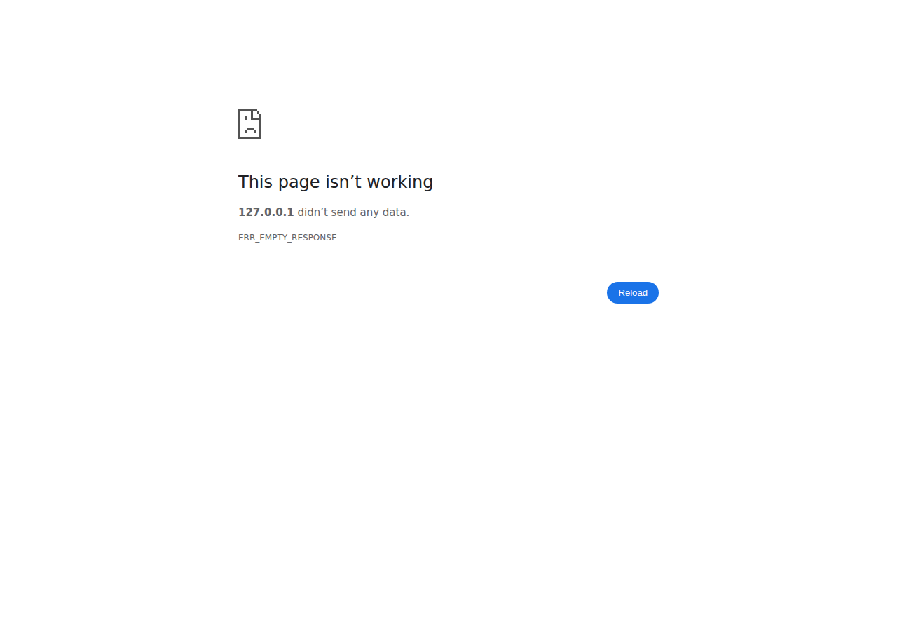
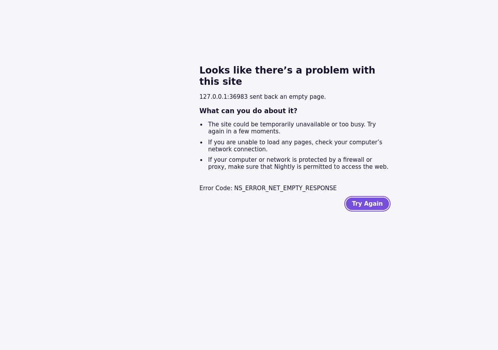

# Testprotokoll – Übungsblatt 03

## Ergebnis

**63 Unittests bestanden: 11 + 15 + 10 + 27.** Dazu echte Referenz- und
Oberflächentests mit GoPop3Server, Python-`poplib`, Thunderbird, Chromium und Firefox.
Zwei unabhängige Prüfrunden sind abgeschlossen; ihre tatsächlichen Befunde wurden
behoben und erneut getestet. Es wurde nichts bei Moodle abgegeben.

Primärnachweise:
- [testausgabe.txt](testausgabe.txt): unbearbeitete finale Unittest-Ausgaben.
- [test_ergebnis.json](test_ergebnis.json): gezählte Tests, Laufzeiten, Exitcodes,
  finale Quellhashes und geprüfte Original-/Erklärungs-/Integrationsnachweise.
- [integration_ergebnis.json](integration_ergebnis.json): echter erneuter Go- und
  Browserlauf **nach** den HTTP-Korrekturen, beendet mit Exitcode 0.
- [Thunderbird-Verifikation](ue3.3/screenshots/verifikation.json): echter GUI-Lauf,
  `PASS`, Exitcode 0 und vier erfolgreiche Cleanup-Prüfungen.

## Umgebung und Originalmaterial

Datum: 19.10.2026, lokale Logzeit Europe/Vienna. Python 3.14.7 unter Linux/POSIX.
Die eigentlichen Lösungsprogramme und Unittests verwenden nur die Standardbibliothek.
Optionale Integration: Playwright 1.64.0, Chromium 156.0.8078.4, Firefox 157.0,
Thunderbird 158.0 mit Marionette/Xvfb/ffmpeg, Go 1.27.2.

Originalangabe und Zusatzmaterial wurden aus Moodle abgerufen. `SampleDataBase.py`,
`README.md` und `document_root.zip` sind bytegleich zu den Downloads; die entpackten
Webdateien sind bytegleich zum ZIP-Inhalt. Die drei Webdateien werden in beiden
HTTP-Suites und beiden Browserläufen jeweils bytegenau geprüft. Alle Mailkonten
und Nachrichten sind synthetische Lehrdaten. Keine echten Mailzugänge benutzt.

## Finale Unittests

Aus dem Repository-Hauptverzeichnis:

```sh
PYTHONDONTWRITEBYTECODE=1 python3 -m unittest discover -s ueb03/ue3.2 -v
PYTHONDONTWRITEBYTECODE=1 python3 -m unittest discover -s ueb03/ue3.3 -v
PYTHONDONTWRITEBYTECODE=1 python3 -m unittest discover -s ueb03/ue3.4 -v
PYTHONDONTWRITEBYTECODE=1 python3 -m unittest discover -s ueb03/ue3.5 -v
```

Finaler aufgezeichneter Lauf:
- **Ü3.2:** 11 Tests, 0,424 s, Exitcode 0, `OK`.
- **Ü3.3:** 15 Tests, 1,104 s, Exitcode 0, `OK`.
- **Ü3.4:** 10 Tests, 2,272 s, Exitcode 0, `OK`.
- **Ü3.5:** 27 Tests, 12,231 s, Exitcode 0, `OK`.

Die Zahlen stammen aus den tatsächlichen `Ran ... tests`-Zeilen und wurden
programmatisch summiert. Untertests sind dabei keine zusätzlichen Testmethoden.
Laufzeiten sind Beobachtungen, keine garantierten Obergrenzen.

### Was geprüft wurde

- **Socket-Client:** Login, LIST, RETR, QUIT, fragmentierte Antworten,
  Dot-Unstuffing, leere Mailbox, negative einzeilige Antworten,
  ungültige Begrüßungen/Listen/Framing, Größenlimits, Befehlsinjektion,
  sauberer Kontextabschluss und Ressourcenfreigabe auf Fehlerpfaden.
- **POP3-Server:** Originaldaten, alle Zustände, CRLF/Fragmentierung,
  Dot-Stuffing und Oktettgrößen, CAPA/UIDL/TOP/NOOP, DELE/RSET/QUIT,
  UID-Stabilität, Abbruch-/Timeout-Rollback und Locks. Gleichzeitige
  unterschiedliche Benutzer funktionieren; zweiter Zugriff derselben Mailbox
  wird abgewiesen. Ein zweiter Benutzer wird nur in der Testdatenbank ergänzt,
  nicht im Originalmaterial.
- **HTTP/0.9:** echte headerlose Dateiübertragung, Indexdateien, Binärdateien,
  Prozentkodierung/Query, stille Fehler, Traversal-/Symlink-/FIFO-Abwehr,
  unvollständige/fragmentierte Anfragen, sequenzielle Verarbeitung und
  echter CLI-Prozess mit SIGTERM-Abschluss.
- **HTTP/1.0:** GET/HEAD, Content-Length, Keep-alive/Close, mehrere Requests
  und Pipeline auf derselben Verbindung mit geordneten Antworten,
  eigener Worker je Request, parallele Clients, Limits, Timeout/Slowloris,
  Pfad-/Header-/Versionsfehler, Originaldateien und SIGINT/SIGTERM.
- **Ergänzte Regressionen:** HTTP/0.9 auch im ausgebauten Server, fragmentierter
  Legacy-Request ohne EOF, stille Legacy-Fehler, keine Legacy-Persistenz,
  Latin-1-Headerwerte und zulässige wiederholte Listenheader bei weiterhin
  abgewiesenen doppelten Host-/Content-Length-Feldern und Steuerzeichen.
- **Logger:** normaler **echter Fünf-Sekunden-Zyklus**, nicht bloß verkürztes
  Testintervall; zunächst keine Sofortausgabe, danach Ausgabe und abschließender
  Flush. Ein einzelner Thread schreibt die Einträge aus einer synchronisierten Queue.

Die entsprechenden Testdateien enthalten die ausführbaren Einzelprüfungen.

## Unabhängige Prüfung

**Runde 1:** Eine getrennte Instanz las Angabe und fertige Artefakte, führte die
ursprünglichen 55 Tests aus und ergänzte eigene Rohsocket-Prüfungen. Sie bestätigte
POP3, Pipeline/HEAD/Fehler-Framing und die vorhandenen Mail-/Browsernachweise.
Sie fand fehlende HTTP/0.9-Rückwärtskompatibilität im HTTP/1.0-Ausbau sowie zu
strikte Behandlung zulässiger Headerwerte und wiederholter Listenheader.

**Korrektur:** Legacy-Erkennung und headerlose Antwort ergänzt, Headerregeln
angepasst, acht Regressionstests ergänzt und zeilenweise Erklärung aktualisiert.
Anschließend alle 63 Tests sowie Go-/Browserintegration erneut ausgeführt.

**Runde 2:** Eine andere getrennte Prüfinstanz kontrollierte die korrigierten
Codepfade zeilenweise und führte **37 HTTP-Tests** aus: 27 + 10, beide `OK`,
Exitcode 0. Ursprüngliche Befunde behoben, keine festgestellte Persistenz-,
Framing-, Thread- oder Loggerregression und keine verbliebenen Blocker.

Dokumentierte Grenzen: keine Requestbodies/Chunking, keine gefalteten Header,
begrenzte Liste zusammenführbarer Felder und nur ein HTTP/1.1-Kompatibilitätsausschnitt.
Das sind bewusst kleine Lehrserver, keine vollständigen Produktionsdienste.

## Echte Referenzimplementierungen

### Eigener Client gegen GoPop3Server

Quelle: [GoPop3Server, verwendete Revision](https://github.com/kurthorvath/GoPop3Server/tree/eae717dd98cb0a59e7afd3e857bc1c86660c530d).

Der Quellstand wurde tatsächlich geklont. Für einen sicheren unprivilegierten
Test wurde **eine separate Kopie** von `main.go` ausschließlich an der Bind-Adresse
geändert: `:110` → `127.0.0.1:11119`. Die Originalarbeitskopie blieb unverändert.
Diese Kopie wurde mit Go 1.27.2 kompiliert und als eigener Prozess gestartet.
Keine Änderungen an Konten, Mails oder Protokollverhalten.

Nachweis im finalen Integrations-JSON:
- Begrüßung `+OK Simple POP3 server ready`.
- Echte Anmeldung als öffentliches Laborkonto `alice/secret`.
- `LIST`: Nachricht 1 mit 151, Nachricht 2 mit 115 Oktetten.
- `RETR 1`: 151 Bytes und Betreff `Hello Alice` geprüft; voller empfangener Text gespeichert.
- Bestätigtes `QUIT`, Client geschlossen und Go-Prozess beendet.

Es wird kein Abruf der zweiten Go-Mail oder vollständiger Test aller
Go-Serverfunktionen behauptet. Reproduktion und bewusster Quellpatch sind in
[erklaerung_integration.md](erklaerung_integration.md) erklärt.
Die vom Integrationstreiber eingetragenen Buildmetadaten sind keine
kryptografische Herkunftsprüfung eines beliebigen übergebenen Binaries.

### Python-poplib gegen eigenen Server

`test_poplib_full_session_sizes_capa_uidl_top_noop` verwendet die unabhängige
Standardbibliotheksimplementierung und ruft alle vier Originalmails ab.
STAT/LIST, Oktettzahlen, UIDL, TOP und NOOP werden geprüft. Original-Mailgrößen:
184, 185, 154 und 164 Oktette. Das sind die Python-Lehrdaten, nicht die Go-Mails.

### Echter Thunderbird gegen eigenen Server

Der [GUI-Bericht](ue3.3/gui_testbericht.md) dokumentiert den tatsächlichen Ablauf:
frisches isoliertes Profil, synthetisches Konto, realer TCP-Abruf über POP3,
Inbox anzeigen, Welcome-Mail öffnen und Inhalt prüfen.

Das [Verifikations-JSON](ue3.3/screenshots/verifikation.json) enthält:
`CAPA → USER → PASS <redacted> → STAT → LIST → UIDL → RETR 1–4 → QUIT`.
Vier Betreffe empfangen und auch in der sichtbaren Inbox geprüft; geöffneter Text
stimmt nach Zeilenenden-/Rand-Whitespace-Normalisierung mit der Originalmail überein.
Die vier Betreffe sind `Welcome to the POP3 lab`, `Network Programming Exercise`,
`Meeting tomorrow` und `POP3 server test`.


Die blaue `3` im zweiten Bild zählt **ungelesene** Nachrichten; die Kopfzeile zeigt
weiterhin `4 Messages`. Die Screenshots wurden tatsächlich visuell kontrolliert.
Originaldatenbank und Serverquelle blieben unverändert; ihre Hashes und die
Screenshot-Hashes wurden erneut abgeglichen. Thunderbird beendete sich regulär
mit Exitcode 0, Profil entfernt, Xvfb und Serverthread beendet, Socket geschlossen.

Die [unveränderte Programmausgabe](ue3.3/screenshots/thunderbird_ausgabe.txt) ist
als TXT archiviert; `.log`-Hilfsdateien werden nicht abgegeben. Sie enthält
nichtblockierende Meldungen zur frischen Blocklist-Datenbank und
`SharedDataMap: in shutdown`. Diese werden nicht verschwiegen; alle fachlichen
Prüfungen waren trotzdem erfolgreich. Automatisierung über Marionette ist keine
behauptete manuelle Einrichtung durch Fabio und kein Test des SMTP-Versands.

## Echte Browser

Beide Browser wurden nach den HTTP-Korrekturen erneut tatsächlich gestartet:
**Chromium 156.0.8078.4** und **Firefox 157.0**.

### Ü3.5: erfolgreiche Anzeige

Beide: Status 200, HTML bytegleich, Titel `Test`, Text `It works...!`, beide Bilder
vollständig dekodiert (`complete` und `naturalWidth > 0`). Zusätzlich wurden
`index.html`, `images/logo.gif` und `images/TechnikErleben.png` per Browser-API
abgerufen und bytegenau verglichen. Diese Rohbytechecks und die echte Seitennavigation
sind getrennte Prüfungen.


### Ü3.4: erwartete Inkompatibilität

Beide Browser zeigen die Seite des strikten HTTP/0.9-Servers **nicht**.
Chromium-Navigation: `net::ERR_EMPTY_RESPONSE`; Firefox-Navigation:
`NS_ERROR_NET_RESET`, im sichtbaren Fehlerdokument `NS_ERROR_NET_EMPTY_RESPONSE`.
Die genauen dynamischen Ports und Originalfehlertexte stehen im JSON.





Die Browser schicken bereits HTTP/1.x-Anfragen. Ü3.4 akzeptiert gemäß seiner
Aufgabe nur `GET /pfad\r\n` und schließt bei Fehlern ohne Rückmeldung.
Das ist ein real beobachteter Syntaxkonflikt, kein erfolgreicher alter HTTP-Body,
der anschließend bloß falsch gerendert worden wäre. Die korrekte HTTP/0.9-
Dateiübertragung ist mit passenden Socketanfragen positiv getestet. Ü3.5
unterstützt beide Requestformen; moderne Browser erhalten dort HTTP/1.0-Antworten.

Die HTTP-Logeinträge enthalten reale Zeitpunkte mit Wiener UTC-Offset, Methode,
IP, Clientport, Status und Request-Worker. Einzelne Browser-Zusatzabrufe liefern
404; alle ausdrücklich geprüften Originaldateien lieferten 200. Da kein URL-Pfad
im Log steht, wird die Ursache der Zusatzabrufe nicht als sicher behauptet.

## Reproduktion und Nachweisgrenzen

- [README](README.md): normale CLI-Starts und Unitbefehle.
- [Integrationserklärung](erklaerung_integration.md): separate Browserumgebung,
  Go-Quellprüfung/-Build und Integration mit optionalem `--go-server`.
- [GUI-Bericht](ue3.3/gui_testbericht.md): Thunderbird mit optionalem
  `marionette_driver`, freiem Xvfb-Display und eigenem Ausgabeordner.

Die optionalen Tests überschreiben ihre gleichnamigen Berichte/Screenshots;
vor Wiederholung sichern oder eine getrennte Arbeitskopie verwenden.
Kein `python -O`: Assertions sind Bestandteil der Integrationsprüfungen.
Das Integrations-JSON entsteht nur bei vollständigem Erfolg; nach einem späteren
Abbruch könnte ein alter Bericht zurückbleiben. Bei einer späteren Wiederholung
Quellstand, Ausgabe und Zeitpunkte gemeinsam prüfen, nicht nur die Existenz einer Datei.
Das Datum im Integrationstreiber ist die feste Kennzeichnung dieses dokumentierten Laufs.

Keine Last-/Penetrationstests, keine öffentliche Bereitstellung, kein TLS-/SMTP-
oder PCAP-Nachweis behauptet. Der Klartextbetrieb bleibt auf lokale Lehrdaten
beschränkt. Der Gruppennummernplatzhalter wird nicht geraten; kein Abgabe-ZIP gebaut.

## KI-Kennzeichnung

Hermes Agent; OpenAI gpt-6.1-sol, `hermes status`: ChatGPT or Codex Subscription.
Datum: 2026-10-19. Auftrag: Blatt03 implementieren, Originalmaterial verwenden,
wirklich testen, unabhängige Prüfung und Korrekturen durchführen, Ergebnisse mit
echten Nachweisen erklären. Keine studentische Eigenleistung wird behauptet.
