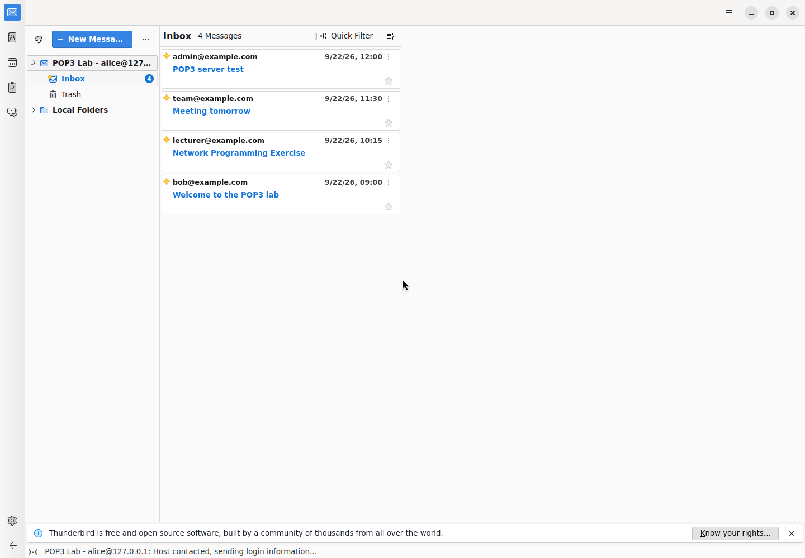
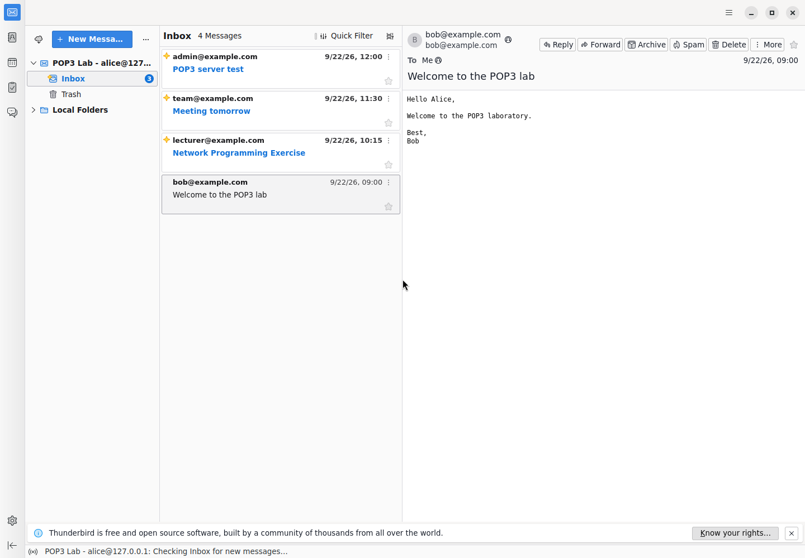

<!-- KI-Kennzeichnung: Hermes Agent / OpenAI gpt-6.1-sol (hermes status: ChatGPT or Codex Subscription). Datum: 2026-10-19. Auftrag: echten Thunderbird-GUI-Integrationstest ausführen und mit Screenshots, Verifikationslog und zeilenweiser Erklärung dokumentieren. -->

# Thunderbird-GUI-Testbericht – Ü3.3

## Ergebnis: bestanden

Der Test wurde **tatsächlich mit Mozilla Thunderbird 158.0** ausgeführt, nicht mit einem nachgebauten Mailfenster. Der erfolgreiche Lauf am **19.10.2026, 12:35:42–12:35:45 UTC** endete mit Prozess-Exitcode **0** und `status: PASS` in [screenshots/verifikation.json](screenshots/verifikation.json).

Thunderbird lief in einem eigenen Xvfb-Display `:183` mit 1440 × 1000 Pixeln und einem neuen, danach gelöschten Profil. Marionette bediente die echte Thunderbird-Oberfläche über deren privilegierte interne APIs. Der unveränderte POP3-Server lief parallel im Thread auf `127.0.0.1:40089`; der Port wurde durch `port=0` dynamisch vergeben. Die Originaldatenbank wurde über die vorhandene Server-API geladen. Es wurden keine Nachrichten direkt in das Thunderbird-Profil geschrieben.

## Nachweise

| Prüfung | Beobachtung |
|---|---|
| Authentifizierung | Thunderbird sendete `USER alice` und `PASS`; das Passwort ist im Protokoll geschwärzt. |
| Originalnachrichten | Genau `RETR 1`, `RETR 2`, `RETR 3`, `RETR 4`; danach `QUIT`. |
| Inbox | Vier Nachrichten; alle vier Originalbetreffe stimmen mit der Originaldatenbank und Thunderbirds Nachrichtenansicht überein. |
| Geöffnete Mail | „Welcome to the POP3 lab“ von `bob@example.com`; sichtbarer Nachrichtentext stimmt nach Rand-Whitespace-/Zeilenenden-Normalisierung mit dem Original überein. |
| Keine Löschung | Vier Nachrichten bleiben in der Serverdatenbank; `leave_on_server=True`. Der aufgezeichnete Ablauf enthält kein `DELE`. |
| Quellschutz | SHA-256 von `pop3_server.py` und `SampleDataBase.py` ist vor und nach dem Test identisch. |
| Beenden | Thunderbird regulär mit Exitcode 0; Xvfb beendet; Serverthread beendet; Serversocket geschlossen; temporäres Profil entfernt. |

Die vier Originalbetreffe:

- Welcome to the POP3 lab
- Network Programming Exercise
- Meeting tomorrow
- POP3 server test

Der geprüfte Mailtext:

```text
Hello Alice,

Welcome to the POP3 laboratory.

Best,
Bob
```

### Echte Inbox-Aufnahme



### Echte Aufnahme der geöffneten Mail



Beide PNGs wurden mit `ffmpeg -f x11grab` direkt aus dem echten X-Display aufgenommen und anschließend visuell geprüft. Alle Betreffzeilen sind vollständig lesbar; der Text der geöffneten Mail ist sichtbar. Die blaue `3` neben „Inbox“ im zweiten Bild bezeichnet **drei ungelesene** Nachrichten nach dem Öffnen, nicht die Gesamtzahl. Oben steht weiterhin „4 Messages“. Die kurz nach dem Abruf noch sichtbaren Statuszeilentexte sind Thunderbird-UI-Statusmeldungen; das aufgezeichnete POP3-`QUIT` ist bereits erfolgt.

### Dateien und Integrität

- [gui_test.py](gui_test.py): eigenständiger optionaler GUI-Test, keine Änderung am Servercode.
- [erklaerung_gui.md](erklaerung_gui.md): Erklärung jeder nichtleeren Codezeile einschließlich der eingebetteten JavaScript-Aufrufe.
- [screenshots/verifikation.json](screenshots/verifikation.json): maschinenlesbare Istwerte, POP3-Befehle ohne Passwort, Zeitstempel, Prozess-IDs, Quell- und Screenshot-Hashes, Cleanup-Ergebnis.
- [screenshots/thunderbird_ausgabe.txt](screenshots/thunderbird_ausgabe.txt): unveränderte Archivkopie der Ausgabe von Thunderbird und Xvfb des erfolgreichen Laufs. Das Testprogramm erzeugt sie zunächst als `thunderbird.log`; die Log-Hilfsdatei wird nicht mit abgegeben.

SHA-256 der unveränderten Quellen:

```text
pop3_server.py     9ee43eadcab08b4bec575b8428b091dc9999a5853c48b8d9154ae351a8083e96
SampleDataBase.py  71f16433a5218c2a21fb696c86cc828a7613b213693b329b558aaf2e73a92297
```

## Wiederholen

Voraussetzungen unter Linux: ausführbares Thunderbird, `Xvfb`, `ffmpeg` und das **nur für diesen Test benötigte** Python-Paket `marionette_driver`. Der POP3-Server selbst benötigt dieses Zusatzpaket nicht. Eine separate virtuelle Python-Umgebung verwenden; externe Testabhängigkeiten und Thunderbird-Binärdateien nicht ins Abgabeverzeichnis kopieren.

Aus dem Repository-Stamm, mit passend gesetztem `THUNDERBIRD_BIN`:

```bash
python3 ueb03/ue3.3/gui_test.py --thunderbird "$THUNDERBIRD_BIN"
```

Wenn das optionale Paket außerhalb der aktiven Python-Umgebung liegt, dessen Installationsverzeichnis über `PYTHONPATH` einbinden. Im tatsächlich ausgeführten Lauf wurde genau diese Variante mit dem bereitgestellten Thunderbird-Binary und dem externen Abhängigkeitsverzeichnis benutzt. Es gibt keine fest eincodierten privaten Installationspfade im Test.

Mit `--display :184` kann ein anderes freies Display gewählt werden; belegte Displays werden abgewiesen. Mit `--output <verzeichnis>` lassen sich neue Belege getrennt ablegen. Ohne diese Option werden die Dateien in `screenshots/` beim nächsten Lauf überschrieben. Ein bereits separat gestarteter POP3-Server ist nicht nötig: Der Test startet und beendet seine eigene Instanz mit der Originaldatenbank.

## Grenzen und behobene Probleme

- Getestet wurde Thunderbird **158.0**. Die verwendeten internen Thunderbird-APIs können sich zwischen Versionen ändern; ein Versionswechsel muss erneut real getestet werden.
- Der Test prüft erfolgreichen lokalen Abruf und tatsächliche Darstellung. Er ersetzt keine separaten Negativ-, Parallelitäts-, Lösch-, TLS- oder Sicherheitstests.
- In einem ersten Entwicklungsdurchlauf war der Mailabruf bereits erfolgreich, der Test scheiterte aber am Beenden: `Marionette.quit()` erlaubt keine außerhalb von Marionette gestartete Gecko-Instanz. Der endgültige Test beendet Thunderbird über `Services.startup.quit`, trennt die Automatisierungssitzung und wartet auf Exitcode 0.
- Ein zusätzlich versuchter synchroner Login-Zähler existiert in Thunderbird 158 nicht. Stattdessen wartet der endgültige Code auf die tatsächliche Auflösung von `addLoginAsync`, bevor der Abruf ausgelöst wird. Der erfolgreiche Lauf wurde danach neu ausgeführt.
- Das unbearbeitete Thunderbird-Log enthält eine noch nicht synchronisierte frische Blocklist-Datenbank und eine `SharedDataMap: in shutdown`-Meldung. Diese Meldungen werden nicht verschwiegen; der lokale Abruf, die Inhaltsprüfung und das reguläre Beenden waren trotzdem erfolgreich.
- Nur synthetisches Konto `alice/secret`, Loopback-POP3 ohne TLS und ein isoliertes Testprofil. Keine persönliche Konfiguration angefasst, kein SMTP-Konto eingerichtet und keine E-Mail versandt. Update-/Telemetrie-/Startseiten-Präferenzen werden reduziert; eine vollständige Netzwerksandbox oder Paketaufzeichnung ist **nicht** Bestandteil dieses Tests.
- Keine Commits, kein Push und keine Queue-Aktionen.
